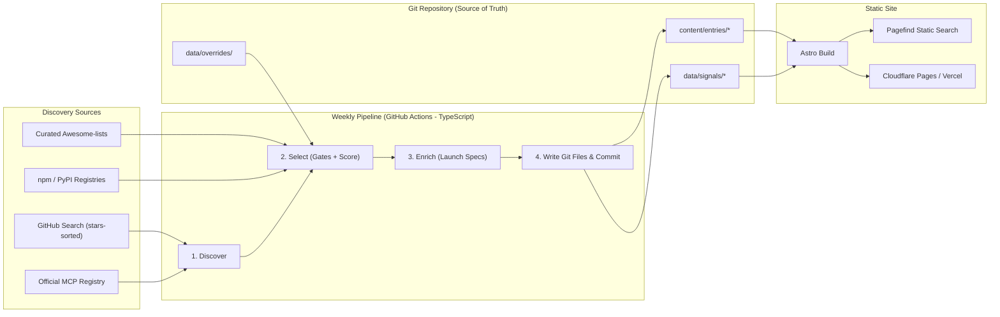
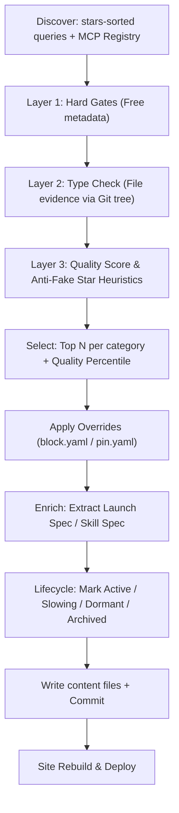
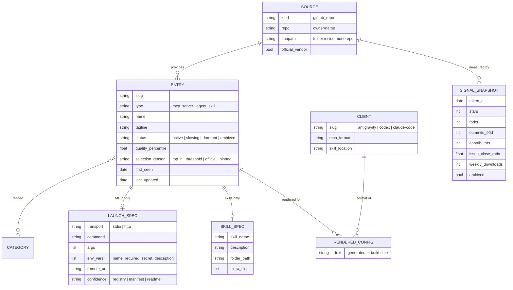

# 01. Project Architecture (v3)

> **Status:** Finalized & Active (October 2026).  
> **Source of Truth:** Git (`content/entries/*`).  
> **Companion Documents:** [02_REPO_QUALITY_CRITERIA.md](file:///c:/teikmin/exploring/web_database/docs/02_REPO_QUALITY_CRITERIA.md), [08_PRODUCT_AND_ARCHITECTURE_REVIEW.md](file:///c:/teikmin/exploring/web_database/docs/08_PRODUCT_AND_ARCHITECTURE_REVIEW.md), [09_V3_WEB_DICTIONARY_AND_TRENDING_PLAN.md](file:///c:/teikmin/exploring/web_database/docs/09_V3_WEB_DICTIONARY_AND_TRENDING_PLAN.md).  
> **Supersedes:** Legacy v1 and v2 catalog specifications.

---

## 1. Executive Summary & Vision

**Working Title:** AI Tools Web Dictionary & Weekly Trend Radar  
**Founder:** Teh Teik Min  
**Core Purpose:** An authoritative, zero-maintenance, Git-backed dictionary and velocity radar designed to reference, define, and track the fastest-growing AI agent tools across the entire ecosystem.

### The 3 Pillars of AI Tooling
1. **MCP Servers (`mcp_server`):** Headless Model Context Protocol servers providing structured database, filesystem, browser automation, and API integrations.
2. **Agent Skills (`agent_skill`):** Reusable task instruction sets and prompts in `SKILL.md` format, packaged into repository **Skill Packs**.
3. **Agent Tools & Repos (`agent_tool`):** Standalone autonomous coding agents, desktop harnesses, and developer frameworks with quickstart install commands.

---

## 2. Finalized Decisions Log (v3.0)

| # | Question | Decision |
|---|---|---|
| 1 | **Source of truth** | **Git** (structured Markdown in `content/entries/`; zero runtime SQL/Supabase) |
| 2 | **Ecosystem Scope** | **3 Pillars:** MCP Servers, Agent Skills, and Agent Tools & Repos |
| 3 | **Velocity & Trends** | **Weekly Velocity Engine (`/trending`)**: computes 7-day star delta $\Delta S_{7\text{d}}$, breakout tools ($\le 60$d), and SVG sparklines |
| 4 | **Distribution** | **Web + RSS 2.0 (`/rss.xml`)** for weekly updates and discoveries |
| 5 | **Target clients** | **Claude Code, OpenAI Codex, Google Antigravity** |
| 6 | **Detail Page UX** | **6-Line Standardized Dictionary Definition Box** with 4-tier deterministic fallback |
| 7 | **Skill Monorepos** | **Skill Packs**: grouped by repository in `/catalog` with expandable drawer |
| 8 | **Category Taxonomy** | **9 Balanced Categories** with dynamic scoring classifier |
| 9 | **Pipeline Safety** | **SG-1 Circuit Breaker**: automated pruning requires explicit `--force-prune` with 5% max deletion limit |
| 10 | **Static Search** | **Pagefind offline search** (<10ms latency, zero API costs) |

---

## 3. Architecture Evolution (v1 $\to$ v2 $\to$ v3)

| Dimension | Legacy Prototype (v1) | Catalog Snippets (v2) | Web Dictionary & Radar (v3) |
|---|---|---|---|
| **Pillars Supported** | Unstructured scrapers | 2 types (MCP, Skills) | **3 Pillars (`mcp_server`, `agent_skill`, `agent_tool`)** |
| **Identity & Scope** | Raw GitHub topic search | Config snippet generator | **AI Tools Web Dictionary & Weekly Trend Board** |
| **Trend Telemetry** | None | Star sort only | **Piecewise Weekly Velocity Engine + Breakout Newcomers** |
| **Categories** | 100+ messy tags | 7 categories (68% in 1 cat) | **9 balanced categories (<25% max each)** |
| **Monorepo Skills** | 1-per-repo or flooded | 538 duplicate skills | **Deduplicated Skill Packs with drawer tables** |
| **Detail Experience** | Raw README | Read-first 60KB README | **6-Line Dictionary Definition Card + README** |


---

## 4. Target Architecture



---

## 5. Pipeline Stages



1. **Discover:** Collects candidates using star-sorted queries with $\ge 100$ stars embedded in the query, plus the official MCP Registry.
2. **Select:** Evaluates candidate repos through 3 filter layers ([02_REPO_QUALITY_CRITERIA.md](file:///c:/teikmin/exploring/web_database/docs/02_REPO_QUALITY_CRITERIA.md)).
3. **Enrich:**
   - **MCP:** Derives executable command, arguments, environment variables, and transport from `server.json`, `package.json`, `pyproject.toml`, or README code blocks.
   - **Skills:** Reads `SKILL.md` frontmatter (`name`, `description`) and directory structure.
4. **Lifecycle:** Automatically tracks repo activity (Active, Slowing, Dormant, Archived).
5. **Write:** Emits Markdown entries with YAML frontmatter to `content/entries/` and weekly snapshot data to `data/signals/`.

### Config Extraction Confidence Levels
Configs display their derivation confidence to provide transparency:
- **Registry (✅):** Extracted from official MCP Registry `server.json`.
- **Manifest (🟢):** Derived from `package.json` bin entries or `pyproject.toml`.
- **README (🟡):** Extracted from README code fences (displayed with a review warning).
- **None:** No executable spec found; links to the upstream repo without a 1-click copy button.

---

## 6. Data Model



### Client Adapters (v1)
Renderers convert a single `LAUNCH_SPEC` into each client's format at build time:

| Client | MCP Server Output | Skill Output | Default Config Path |
|---|---|---|---|
| **Claude Code** | `claude mcp add ...` CLI command & `.mcp.json` snippet | Instructions to install skill folder into `.claude/skills/<name>/` | `.mcp.json` / `~/.claude.json` |
| **Codex** | `.codex/config.json` JSON block | Instructions to install skill folder into `.codex/skills/<name>/` | `.codex/config.json` |
| **Antigravity** | `.gemini/mcp_servers.json` snippet (`mcpServers` object) | Instructions to install skill into `~/.gemini/config/skills/<name>/` | `.gemini/mcp_servers.json` |

---

## 7. Site Navigation & URL Structure

Built with **Astro Static Site Generation (SSG)** and indexed locally with **Pagefind**:

| URL Route | Purpose |
|---|---|
| `/` | Instant search, top tools by category, "New This Week" highlights, official tools |
| `/catalog` | Unified, filterable, searchable catalog grid with client pills, category filter, sort controls, and pagination |
| `/mcp/[slug]` | MCP tool detail: signals, verification confidence, client config tabs, sanitized upstream README |
| `/skills/[slug]` | Agent skill detail: description, target client install paths, full `SKILL.md` preview |
| `/client/[client]` | Client view (`/client/claude-code`, `/client/codex`, `/client/antigravity`) reusing filtered catalog grid |
| `/category/[category]` | Filtered view for categories with $\ge 5$ entries |
| `/changelog` | Weekly diff of added, updated, and archived tools |
| `/about/criteria` | Public transparency page explaining the automated quality formula |

---

## 8. Repository Layout

Top-level summary. The full file-level structure, folder ownership and data flow are in [05_FOLDER_STRUCTURE.md](file:///c:/teikmin/exploring/web_database/docs/05_FOLDER_STRUCTURE.md).

```text
web_dictionary/
├── content/                  # SOURCE OF TRUTH: published catalog
│   ├── entries/{mcp,skills}/ #   pipeline-owned, one Markdown file per entry
│   ├── clients/              #   human-owned client definitions
│   ├── categories/           #   human-owned categories + matching rules
│   └── pages/                #   human-owned about / criteria pages
├── data/
│   ├── overrides/            # block.yaml / pin.yaml (optional)
│   ├── reference/            # vendor orgs, trusted awesome-lists
│   ├── signals/              # weekly metric snapshots
│   ├── runs/                 # per-run report, decisions, diff
│   └── state/                # cross-run tracking (failures, slugs, diff.json)
├── apps/
│   ├── pipeline/             # TypeScript weekly pipeline (sources, stages, enrich, config)
│   └── site/                 # Astro static site + Pagefind
├── packages/
│   ├── schema/               # Shared data shapes (pipeline writes, site reads)
│   └── renderers/            # Launch spec -> Claude Code / Codex / Antigravity configs
├── docs/
└── .github/workflows/        # ci.yml, pipeline.yml (weekly), deploy.yml (on push)
```

---

## 9. Phased Implementation Roadmap

| Phase | Milestone | Deliverables & Exit Criteria | Status |
|---|---|---|:---:|
| **Phase 0: Reset** | Complete | Legacy code deleted, `.env.example` cleaned, docs unified | ✅ Completed |
| **Phase 1: Selection Engine** | Complete | TypeScript discovery + 3-layer filter; generates a **run report**; spot-checked top 30 | ✅ Completed |
| **Phase 2: Enrich & Renderers** | Complete | `LAUNCH_SPEC` extraction; client adapters (Claude Code, Codex, Antigravity); sanitized READMEs | ✅ Completed |
| **Phase 3: Astro Site Live** | Complete | Astro 5 app with Content Collections, Pagefind search, client tabs; automated deploy workflows | ✅ Completed |
| **Reliability Overhaul (P1–P6)** | Complete | Strict type checks, multi-entry skills, honest confidence labels, direct deploy trigger, pruning | ✅ Completed |
| **Frontend UX Overhaul (Phases A–E)** | Complete | Read-first tool pages, `/catalog` filterable grid, light cold-tone theme, honest labels, verified paths | ✅ Completed |
| **Phase 4: Lifecycle & Trends** | Active | Automated archive/dormant status tracking; weekly signal history trends and diffs | 🔄 Active |
