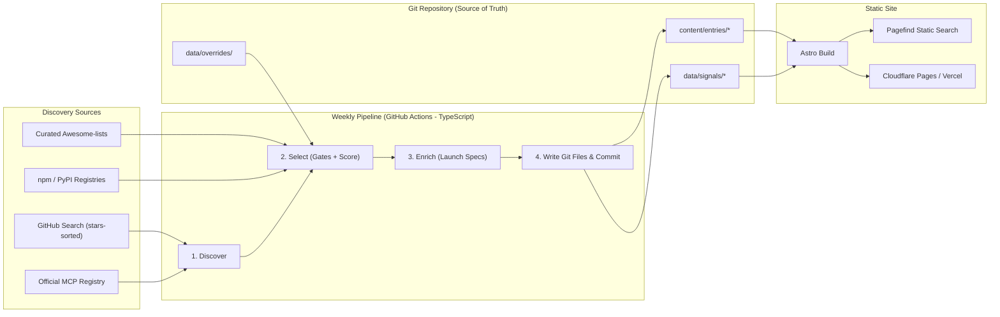
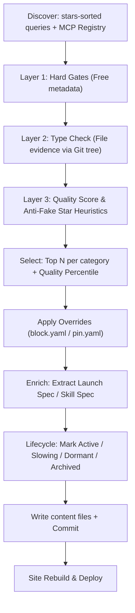

# 01. Project Architecture (v2)

> **Status:** Finalized & Active (2026-10-07).  
> **Source of Truth:** Git (`content/entries/*`).  
> **Companion Document:** [02_REPO_QUALITY_CRITERIA.md](file:///c:/teikmin/exploring/web_database/docs/02_REPO_QUALITY_CRITERIA.md) (Automated selection rules).  
> **Supersedes:** Legacy v1 design documents (`01_PROJECT_OVERVIEW.md`, `02_DATABASE_SCHEMA.sql`, `03_INGESTION_AND_VERIFICATION.md`, and `06_ARCHITECTURE_REDESIGN.md`).

---

## 1. Executive Summary & Vision

**Working Title:** AI Tools Hub / MCP & Agent Registry  
**Founder:** Teh Teik Min  
**Core Purpose:** A personal-first knowledge repository and developer utility built to discover, filter, and reference high-quality AI tools across the rapidly evolving ecosystem. 

While built primarily for personal productivity and learning, it is published openly as a high-signal public directory for developers building with AI agents.

### The Problem
The AI tooling ecosystem is expanding exponentially. Developers are constantly adopting Model Context Protocol (MCP) servers, agent skills, and workflow configs. However:
- Discovery is fragmented across GitHub topics, Reddit threads, and individual READMEs.
- Low-quality, abandoned, or star-farmed repositories overwhelm search results.
- Configuring tools in different clients (**Claude Code**, **Codex**, **Antigravity**) requires manual, error-prone JSON and TOML edits.

### The Solution
A zero-database, Git-backed static web catalog powered by an automated TypeScript pipeline:
1. **Curated automatically:** Scrapes wide, verifies file evidence, filters with strict quality gates ($\ge 100$ stars), and publishes narrow.
2. **1-Click Launch Configs:** Renders copy-ready launch snippets tailored specifically for **Claude Code**, **Codex**, and **Antigravity**.
3. **Zero Maintenance Infra:** Completely serverless. Git is the database, Astro is the renderer, Pagefind is the search engine, and GitHub Actions is the pipeline.

---

## 2. Finalized Decisions Log

| # | Question | Decision |
|---|---|---|
| 1 | **Source of truth** | **Git** (structured Markdown files in the repo; no runtime database) |
| 2 | **v1 Scope** | **MCP servers + agent skills** |
| 3 | **Target clients** | **Antigravity, Codex, Claude Code** |
| 4 | **Private notes** | **None.** Everything in the repo is public |
| 5 | **Triage interface** | **Not needed.** Selection is 100% automated by rule |
| 6 | **Pipeline language** | **TypeScript** (shares config renderers with the Astro site) |
| 7 | **Curation model** | **Automatic, rule-based** quality selection (no manual review queues) |
| 8 | **Star minimum** | **$\ge 100$ stars** for both MCP servers and skills (official vendors exempt) |
| 9 | **Catalog size target** | **$\sim 500$ entries cap** in v1 |
| 10 | **Submissions** | **Out of scope for v1.** No community submission UI |

---

## 3. Why the Architecture was Redesigned (v1 vs v2)

A prototype dry run of the initial topic-scraping pipeline produced **3,478 records across 3,110 repos**, with a **median star count of 1**. Over 40% received a "Healthy" badge due to circular metrics.

| Issue in v1 | Root Cause | v2 Redesign Solution |
|---|---|---|
| **High noise catalog** | Scraped everything matching topics | Three-layer filter with a hard $\ge 100$ star gate ([02_REPO_QUALITY_CRITERIA.md](file:///c:/teikmin/exploring/web_database/docs/02_REPO_QUALITY_CRITERIA.md)) |
| **Volatile listings** | Search sorted by `updated` | Search sorted by `stars`; curated entries ranked by quality percentile |
| **Misclassified types** | Inferred type from loose topic tags | **File evidence required** (`@modelcontextprotocol/sdk`, `server.json`, `SKILL.md`) |
| **Monorepo collisions** | Assumed 1 repository = 1 resource | Decoupled **Source** (repo) from **Entry** (subfolder/tool) |
| **No 1-click config model** | No schema for client configuration | Unified `LAUNCH_SPEC` rendered into client-specific formats at build time |
| **Database overhead** | Supabase PostgreSQL runtime instance | **Git as database**; Astro Content Collections with static build validation |

---

## 4. Target Architecture



---

## 5. Pipeline Stages



1. **Discover:** Collects candidates using star-sorted queries with $\ge 100$ stars embedded in the query, plus the official MCP Registry.
2. **Select:** Evaluates candidate repos through 3 filter layers ([02_REPO_QUALITY_CRITERIA.md](file:///c:/teikmin/exploring/web_database/docs/02_REPO_QUALITY_CRITERIA.md)).
3. **Enrich:**
   - **MCP:** Derives executable command, arguments, environment variables, and transport from `server.json`, `package.json`, `pyproject.toml`, or README code blocks.
   - **Skills:** Reads `SKILL.md` frontmatter (`name`, `description`) and directory structure.
4. **Lifecycle:** Automatically tracks repo activity (Active, Slowing, Dormant, Archived).
5. **Write:** Emits Markdown entries with YAML frontmatter to `content/entries/` and weekly snapshot data to `data/signals/`.

### Config Extraction Confidence Levels
Configs display their derivation confidence to provide transparency:
- **Registry (✅):** Extracted from official MCP Registry `server.json`.
- **Manifest (🟢):** Derived from `package.json` bin entries or `pyproject.toml`.
- **README (🟡):** Extracted from README code fences (displayed with a review warning).
- **None:** No executable spec found; links to the upstream repo without a 1-click copy button.

---

## 6. Data Model


### Client Adapters (v1)
Renderers convert a single `LAUNCH_SPEC` into each client's format at build time:

| Client | MCP Server Output | Skill Output | Default Config Path |
|---|---|---|---|
| **Claude Code** | `claude mcp add ...` CLI command & `.mcp.json` snippet | Instructions to install skill folder into `.claude/skills/<name>/` | `.mcp.json` / `~/.claude.json` |
| **Codex** | `.codex/config.json` JSON block | Instructions to install skill folder into `.codex/skills/<name>/` | `.codex/config.json` |
| **Antigravity** | `.gemini/mcp_servers.json` snippet (`mcpServers` object) | Instructions to install skill into `~/.gemini/config/skills/<name>/` | `.gemini/mcp_servers.json` |

---

## 7. Site Navigation & URL Structure

Built with **Astro Static Site Generation (SSG)** and indexed locally with **Pagefind**:

| URL Route | Purpose |
|---|---|
| `/` | Instant search, top tools by category, "New This Week" highlights, official tools |
| `/catalog` | Unified, filterable, searchable catalog grid with client pills, category filter, sort controls, and pagination |
| `/mcp/[slug]` | MCP tool detail: signals, verification confidence, client config tabs, sanitized upstream README |
| `/skills/[slug]` | Agent skill detail: description, target client install paths, full `SKILL.md` preview |
| `/client/[client]` | Client view (`/client/claude-code`, `/client/codex`, `/client/antigravity`) reusing filtered catalog grid |
| `/category/[category]` | Filtered view for categories with $\ge 5$ entries |
| `/changelog` | Weekly diff of added, updated, and archived tools |
| `/about/criteria` | Public transparency page explaining the automated quality formula |

---

## 8. Repository Layout

Top-level summary. The full file-level structure, folder ownership and data flow are in [05_FOLDER_STRUCTURE.md](file:///c:/teikmin/exploring/web_database/docs/05_FOLDER_STRUCTURE.md).

```text
web_dictionary/
├── content/                  # SOURCE OF TRUTH: published catalog
│   ├── entries/{mcp,skills}/ #   pipeline-owned, one Markdown file per entry
│   ├── clients/              #   human-owned client definitions
│   ├── categories/           #   human-owned categories + matching rules
│   └── pages/                #   human-owned about / criteria pages
├── data/
│   ├── overrides/            # block.yaml / pin.yaml (optional)
│   ├── reference/            # vendor orgs, trusted awesome-lists
│   ├── signals/              # weekly metric snapshots
│   ├── runs/                 # per-run report, decisions, diff
│   └── state/                # cross-run tracking (failures, slugs, diff.json)
├── apps/
│   ├── pipeline/             # TypeScript weekly pipeline (sources, stages, enrich, config)
│   └── site/                 # Astro static site + Pagefind
├── packages/
│   ├── schema/               # Shared data shapes (pipeline writes, site reads)
│   └── renderers/            # Launch spec -> Claude Code / Codex / Antigravity configs
├── docs/
└── .github/workflows/        # ci.yml, pipeline.yml (weekly), deploy.yml (on push)
```

---

## 9. Phased Implementation Roadmap

| Phase | Milestone | Deliverables & Exit Criteria | Status |
|---|---|---|:---:|
| **Phase 0: Reset** | Complete | Legacy code deleted, `.env.example` cleaned, docs unified | ✅ Completed |
| **Phase 1: Selection Engine** | Complete | TypeScript discovery + 3-layer filter; generates a **run report**; spot-checked top 30 | ✅ Completed |
| **Phase 2: Enrich & Renderers** | Complete | `LAUNCH_SPEC` extraction; client adapters (Claude Code, Codex, Antigravity); sanitized READMEs | ✅ Completed |
| **Phase 3: Astro Site Live** | Complete | Astro 5 app with Content Collections, Pagefind search, client tabs; automated deploy workflows | ✅ Completed |
| **Reliability Overhaul (P1–P6)** | Complete | Strict type checks, multi-entry skills, honest confidence labels, direct deploy trigger, pruning | ✅ Completed |
| **Frontend UX Overhaul (Phases A–E)** | Complete | Read-first tool pages, `/catalog` filterable grid, light cold-tone theme, honest labels, verified paths | ✅ Completed |
| **Phase 4: Lifecycle & Trends** | Active | Automated archive/dormant status tracking; weekly signal history trends and diffs | 🔄 Active |
