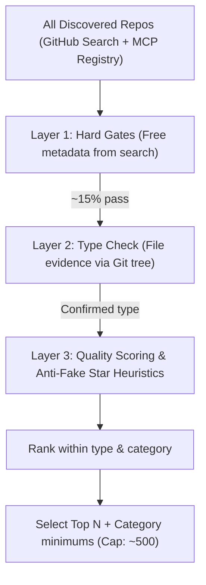

# 02. Repo Quality Criteria (Automatic Selection)

> **Purpose:** Define how the pipeline decides **automatically** which GitHub repos are worth publishing, with zero human review.  
> **Used by:** The *Select* stage in [01_ARCHITECTURE.md](file:///c:/teikmin/exploring/web_database/docs/01_ARCHITECTURE.md).  
> **Status:** Active starting specification (tuned during Phase 1 run reports).

---

## 1. Where These Criteria Come From

No single standard defines a "high-value repository." These criteria adapt signals from established package-health and security standards:

| Framework / Tool | What It Measures | How We Use It |
|---|---|---|
| **OpenSSF Scorecard** | Maintenance practices, CI, branch protection, pinned dependencies, security policy | Maintenance & trust baseline |
| **CHAOSS Metrics** | Community health: issue response time, contributor count, bus factor | Activity & community sustainability |
| **Libraries.io SourceRank** | Stars, dependents, contributors, releases, license, documentation | Overall composite scoring shape |
| **npm / PyPI Health Scores** | Download volume, release cadence, package integrity | Real adoption signal (downloads > stars) |
| **Academic Star Research** (e.g. StarScout) | Synthetic star velocity, star-to-fork imbalances | Defence against star farming |

**Consensus Principle:** Stars alone are a noisy, easily gamed metric. Genuine quality requires **multiple independent signals to agree**: active usage (downloads/dependents), ongoing maintenance (recent commits, issues resolved), multi-maintainer community (bus factor $\ge 2$), and external trust (official registry or vendor listing).

---

## 2. The Three-Layer Filter

To optimize GitHub API rate limits, layers run in increasing order of cost:

---

## 3. Layer 1 — Hard Gates (Must Pass ALL)

These filters use metadata already returned in GitHub Search results and cost zero additional API calls.

| # | Gate | Rule | Rationale |
|---|---|---|---|
| **G1** | Not Archived | `archived == false` | Archived projects are abandoned |
| **G2** | Not a Fork | `fork == false` | Prevents duplicate listings of upstream tools |
| **G3** | Not a Template / Mirror | `is_template == false`, no "mirror" in description | Filters out starters and unmaintained mirrors |
| **G4** | Minimum Stars | **$\ge 100$ stars** *(official vendor repos exempt)* | Filters out hobby projects and abandoned experiments |
| **G5** | Recent Activity | Pushed within **180 days** | Tools in fast-moving agent ecosystems break quickly |
| **G6** | Minimum Age | Created **$\ge 30$ days** ago | Blunts sudden hype spikes and newly created star-farms |
| **G7** | Open Source License | Valid OSI-approved license | Guarantees legal usability |
| **G8** | Quality Description | Non-empty, $\ge 20$ characters | Signals minimum documentation polish |
| **G9** | Not a Course / Demo | Name/topics do not match `awesome-`, `tutorial`, `course`, `for-beginners`, `examples`, `boilerplate`, `starter` | Eliminates educational lists that lack executable tools |

> [!TIP]
> Embed Gate G4 directly into GitHub Search API queries (e.g., `topic:mcp-server stars:>=100 archived:false fork:false sort:stars`) to retrieve only pre-qualified repositories and preserve the search rate limit.

> [!NOTE]
> **Finding Skills via Code Search:** Many skill repositories lack consistent topic tags. In addition to topic queries, skill discovery utilizes GitHub Code Search for `filename:SKILL.md`, applying the same hard gates to the parent repository.

---

## 4. Layer 2 — Type Check (File Evidence Required)

Keyword topics frequently produce false positives. **A repository is accepted only if verified by file evidence in its source tree**:

### MCP Server (Requires at least one)
- Listed in the **Official MCP Registry** (`registry.modelcontextprotocol.io`).
- Manifest declaration: Contains a `server.json` or manifest file.
- SDK dependency: `package.json` depends on `@modelcontextprotocol/sdk`, or `pyproject.toml` / `requirements.txt` includes `mcp` or `fastmcp`, or references the official Go, Rust, or C# SDKs.

### Agent Skill (Requires at least one)
- Contains `SKILL.md` files (with structured YAML frontmatter containing `name` and `description`).
- Contains a valid plugin manifest targeting **Claude Code**, **Codex**, or **Antigravity**.

### Monorepo Extraction & Sub-entry Evidence
If a single repository contains multiple MCP servers or multiple `SKILL.md` subdirectories, **each tool is ingested as an independent Entry** referencing its specific repository subpath.

> [!WARNING]
> **Sub-entry Evidence Rule:** To prevent a popular monorepo (e.g. $\ge 5,000$ stars) from flooding the catalog with trivial or unmaintained utilities, each sub-entry must carry its own verifiable evidence: its own official registry listing, independent package downloads, or recent commits in that specific subfolder.

---

## 5. Layer 3 — Quality Scoring (For Ranking)

Executed exclusively on candidates that have passed Layers 1 and 2. Data is acquired via batched GitHub GraphQL calls, package registry APIs (npm/PyPI), and OpenSSF Scorecard.

| Dimension | Weight | Signals (Percentile against peers of the same type) |
|---|:---:|---|
| **Adoption** | 30% | Weekly npm/PyPI downloads (log scale), GitHub stars (log scale), forks, dependent repositories |
| **Maintenance** | 25% | Commits in last 90 days, days since last release, releases in last 12 months, issue close ratio |
| **Community** | 15% | Contributors with $>1$ commit (bus factor $\ge 2$), top contributor commit concentration |
| **Trust** | 20% | Verified organization, official vendor, official MCP Registry listing, OpenSSF Scorecard |
| **Docs & Packaging** | 10% | Semantic versioning, active CI, README installation instructions, example configurations |

### Selection Rules (Cap of ~500 Entries)
Entries meeting all criteria are admitted in priority order:
1. **Official Vendors & Pinned Repos:** Always included (exempt from star count).
2. **Category Minimums:** The top 5 tools in any category with $\ge 5$ qualifying candidates.
3. **Type Percentile Rank:** Filled by quality percentile up to **$\sim 350$ MCP servers** and **$\sim 150$ Agent skills**.

> [!IMPORTANT]
> **500 is a cap, not a quota.** The 100-star minimum is never lowered to fill empty slots. If fewer entries qualify, the catalog is simply smaller. Quality strictly takes precedence over quantity.

---

## 6. Anti-Fake Star Heuristics

Repositories triggering **two or more** of these heuristics are automatically excluded:

1. **Unnatural Star/Fork Ratio:** Forks $\div$ stars $< 0.01$ on repositories with $> 500$ stars.
2. **Zero Subscriber Engagement:** Watchers $\div$ stars is abnormally low compared to peer tools.
3. **Ghost Commits:** High star count combined with fewer than 5 lifetime commits.
4. **Sudden Velocity Spikes:** Significant portion of stars acquired in a brief temporal spike.
5. **Zero Package Consumption:** High GitHub stars but near-zero weekly npm/PyPI downloads.

---

## 7. Overrides & Catalog Lifecycle

### Manual Overrides (Rarely Used)
- `data/overrides/block.yaml`: Force-excludes spammy, malicious, or non-functional repositories.
- `data/overrides/pin.yaml`: Force-includes high-value niche tools that miss automatic gates.

### Automatic Removal Rules
- **Archived:** Upstream repo marked archived $\to$ labeled *Archived*, hidden from active lists after 30 days, detail page preserved to keep URLs intact.
- **Dormant:** No commits for $365+$ days $\to$ labeled *Dormant*, excluded from top rankings.
- **Failures:** Fails hard gates for 3 consecutive weekly pipeline cycles $\to$ unlisted.
- **Deleted:** Repository removed or set to private $\to$ redirect page to parent category.
