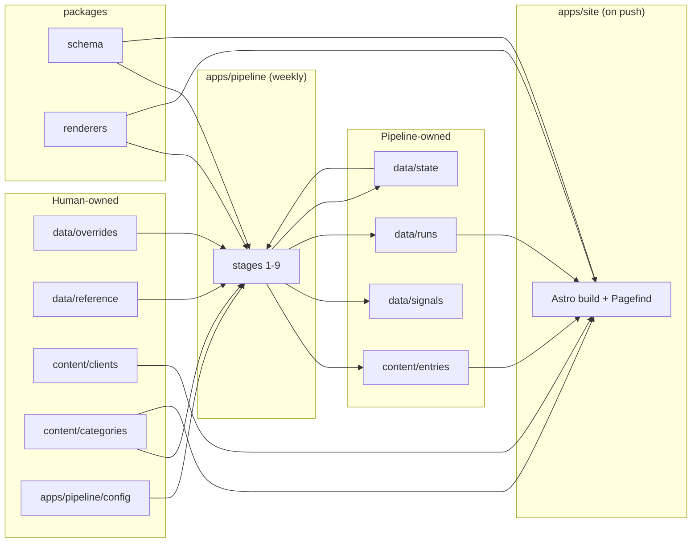

# 05. Folder Structure

> **Status:** Proposed (2026-10-07)
> **Reference architecture:** [01_ARCHITECTURE.md](file:///c:/teikmin/exploring/web_database/docs/01_ARCHITECTURE.md)
> **Scope:** The full repository layout down to file level, who owns each folder, and how data moves between folders. No code.

---

## 1. Design principles

1. **Data and code live apart.** `content/` and `data/` hold *what* is published. `apps/` and `packages/` hold *how* it's produced. You can browse the catalog on GitHub without reading any code.
2. **One schema, used twice.** The pipeline *writes* entry files and the site *reads* them, and both validate against the **same schema package**. If the pipeline writes a bad entry, the site build fails before anything is deployed.
3. **One renderer, used twice.** Client config formats (Claude Code / Codex / Antigravity) are defined once in `packages/renderers`. The pipeline uses them to check configs and the site uses them to display configs.
4. **Every folder has exactly one owner:** the pipeline, you, or the build. No folder is edited by both a human and the pipeline.
5. **Tunable values are data, not code.** Thresholds, weights, vendor lists and category rules sit in plain config/data files, so tuning never means touching logic.

---

## 2. Ownership legend

| Mark | Owner | Rule |
|:---:|---|---|
| 🤖 | **Pipeline** | Written by the weekly run. **Never edit by hand**; changes are overwritten. |
| ✍️ | **Human** | Maintained by you. The pipeline only reads it. |
| ⚙️ | **Code** | Source code and tests. |
| 🚫 | **Build / local only** | Generated, ignored by git. |

---

## 3. Top-level layout

```text
web_database/
├── content/          🤖✍️  The published catalog (Git = database)
├── data/             🤖✍️  Pipeline inputs, outputs and history
├── apps/
│   ├── pipeline/     ⚙️    Weekly TypeScript pipeline (discover → select → enrich → write)
│   └── site/         ⚙️    Astro static site
├── packages/
│   ├── schema/       ⚙️    Shared data shapes + validation (used by pipeline AND site)
│   └── renderers/    ⚙️    Launch spec → client configs (used by pipeline AND site)
├── docs/             ✍️    Architecture and planning docs
├── .github/          ⚙️    CI, weekly pipeline, deploy workflows
└── (root config files)
```

**Why `apps/` + `packages/`:** the pipeline and the site both depend on the schema and the renderers. A small **pnpm workspace** lets both import them directly, with no copying or publishing. This is the main change from the outline in `01_ARCHITECTURE.md` §8 (see the mapping in §11).

---

## 4. `content/` — the published catalog

Astro reads this folder directly as Content Collections. Every file here becomes or shapes a page.

```text
content/
├── entries/                         🤖 Pipeline-owned
│   ├── mcp/
│   │   ├── stripe-agent-toolkit.md
│   │   ├── modelcontextprotocol-servers-filesystem.md   ← monorepo sub-entry
│   │   └── …                        (~350 files)
│   └── skills/
│       ├── anthropics-skills-pdf.md                     ← one entry per SKILL.md folder
│       └── …                        (~150 files)
├── clients/                         ✍️ Human-owned
│   ├── claude-code.yaml
│   ├── codex.yaml
│   └── antigravity.yaml
├── categories/                      ✍️ Human-owned
│   ├── databases.yaml
│   ├── browser-automation.yaml
│   ├── dev-tools.yaml
│   └── …                            (fixed list of ~8–12, plus other.yaml)
└── pages/                           ✍️ Human-owned
    ├── about.md
    └── criteria.md                  Public version of 02_REPO_QUALITY_CRITERIA.md
```

### 4.1 Entry file conventions

| Rule | Convention |
|---|---|
| **File name = slug** | Lowercase, hyphenated: `<owner>-<repo>` for single-tool repos, `<owner>-<repo>-<subfolder>` for monorepo sub-entries |
| **Slug is permanent** | Once published, a slug never changes (keeps URLs stable). If a repo is renamed, the `source.repo` field changes, not the slug |
| **Format** | Markdown with structured frontmatter. The frontmatter holds all data; the body holds only a short generated summary |
| **No copied READMEs** | Only metadata, a short tagline, and links. Don't copy upstream README text (licensing and duplicate-content reasons) |

### 4.2 Entry frontmatter fields (MCP entry)

| Group | Fields |
|---|---|
| Identity | `slug`, `type`, `name`, `tagline`, `categories` |
| Source | `source.repo`, `source.subpath`, `source.homepage`, `source.package` (npm/PyPI name), `source.official_vendor`, `source.license` |
| Selection | `status` (active / slowing / dormant / archived), `quality_percentile`, `selection_reason`, `first_seen`, `last_updated` |
| Launch spec | `launch.transport`, `launch.command`, `launch.args`, `launch.env_vars` (name, required, secret, description), `launch.remote_url`, `launch.confidence` |
| Signals (latest) | `signals.stars`, `signals.last_commit`, `signals.weekly_downloads`, `signals.contributors` (a copy of the latest snapshot so pages don't need to load history) |

**Skill entries** swap the launch spec group for: `skill.name`, `skill.description`, `skill.folder_path`, `skill.extra_files`.

### 4.3 Client and category files

| File | Contents |
|---|---|
| `clients/*.yaml` | Display name, logo path, docs link, MCP config format id, MCP config file location(s), skills install location(s), "last checked against official docs" date |
| `categories/*.yaml` | Display name, description, sort order, plus **matching rules** (topics and keywords) the pipeline uses to assign entries automatically |

---

## 5. `data/` — pipeline inputs, outputs and history

```text
data/
├── overrides/                       ✍️ Human-owned (optional; work fine empty)
│   ├── block.yaml                   Never publish these repos (+ reason)
│   └── pin.yaml                     Always publish these repos (+ reason)
├── reference/                       ✍️ Human-owned
│   ├── vendors.yaml                 Official vendor GitHub orgs (e.g. stripe → Stripe); exempt from the star gate
│   └── awesome-lists.yaml           Curated lists used as a trust signal
├── signals/                         🤖 Pipeline-owned
│   └── 2026/
│       ├── 2026-W41.json            One file per week: raw signals for every catalog entry
│       └── …
├── runs/                            🤖 Pipeline-owned
│   └── 2026-W41/
│       ├── report.md                Human-readable summary: counts, top 30 per type, notable changes
│       ├── decisions.json           Every candidate + which gate passed/failed + score parts
│       └── diff.json                Added / removed / status-changed entries (feeds /changelog)
└── state/                           🤖 Pipeline-owned
    └── entries-state.json           Tracking between runs: consecutive gate failures, last seen, slug ↔ repo map
```

| Folder | Why it exists |
|---|---|
| `overrides/` | The two rarely-used escape hatches from `02` §7 |
| `reference/` | Lists you might want to tune without touching code (vendor orgs, trusted lists) |
| `signals/` | Weekly history, so trend charts are possible later (Phase 4). About 500 entries × 52 weeks stays well under 50 MB/year |
| `runs/` | **Explains every decision.** This is how you spot-check Phase 1 and tune thresholds. `diff.json` also makes the changelog deterministic, with no reading of git history at build time |
| `state/` | Things that must survive between runs, e.g. "failed the gates 3 weeks in a row" (removal rule in `02` §7) and permanent slug assignments |

---

## 6. `packages/schema/` — shared data shapes

```text
packages/schema/
├── package.json
└── src/
    ├── index.ts                     Re-exports everything
    ├── entry.ts                     Shared entry fields + MCP and skill variants
    ├── launch-spec.ts               Transport, command, args, env vars, confidence
    ├── skill-spec.ts
    ├── client.ts                    Shape of content/clients/*.yaml
    ├── category.ts                  Shape of content/categories/*.yaml (incl. matching rules)
    ├── signals.ts                   Weekly snapshot shape
    ├── overrides.ts                 block.yaml / pin.yaml / vendors.yaml shapes
    └── run-report.ts                decisions.json / diff.json shapes
```

- Uses the same validation library Astro uses for Content Collections, so **one definition** serves both the pipeline and the site.
- No logic, only shapes. This package has no dependencies on the pipeline or the site.

---

## 7. `packages/renderers/` — client config adapters

```text
packages/renderers/
├── package.json
├── src/
│   ├── index.ts                     Registry: client id → adapter
│   ├── types.ts                     Adapter interface (input: launch spec / skill spec; output: snippets)
│   ├── claude-code.ts               `claude mcp add` command + `.mcp.json` snippet + skills path
│   ├── codex.ts                     `config.toml` block + skills path
│   └── antigravity.ts               `mcp_config.json` snippet + skills path
└── test/
    ├── fixtures/                    Sample launch specs (stdio npm, stdio Python, remote http, env-var heavy)
    └── snapshots/                   Expected output per client per fixture ("golden files")
```

- **Adding a client** = one new adapter file + one `content/clients/*.yaml` + snapshot tests. Nothing else changes.
- **Golden-file tests** make format changes visible: if a client changes its config format, you update one adapter and review the snapshot diff.

---

## 8. `apps/pipeline/` — the weekly pipeline

```text
apps/pipeline/
├── package.json
├── config/                          ✍️ Tunables (no logic)
│   ├── thresholds.yaml              Star minimum (100), activity days (180), min age (30), cap (500), type split (350/150)
│   ├── weights.yaml                 Score weights: adoption 30 / maintenance 25 / trust 20 / community 15 / docs 10
│   ├── queries.yaml                 GitHub search queries per type (topics, SKILL.md code search)
│   └── anti-fake.yaml               Fake-star heuristic thresholds
├── src/
│   ├── cli/                         Entry points (one per command)
│   │   ├── run.ts                   Full run: discover → select → enrich → lifecycle → write
│   │   ├── report.ts                Phase 1 mode: everything except write; outputs data/runs only
│   │   └── stage.ts                 Run a single stage (debugging)
│   ├── sources/                     One adapter per external API, no business logic
│   │   ├── github-search.ts         Repo search (stars-sorted, gates in query)
│   │   ├── github-code-search.ts    SKILL.md discovery
│   │   ├── github-graphql.ts        Batched quality signals (commits, contributors, releases, issues)
│   │   ├── github-contents.ts       Repo tree + manifest files for the type check
│   │   ├── mcp-registry.ts          Official MCP Registry
│   │   ├── npm.ts                   Package metadata + weekly downloads
│   │   ├── pypi.ts                  Package metadata + downloads
│   │   └── openssf.ts               Scorecard results
│   ├── stages/                      One file per pipeline stage, in run order
│   │   ├── 1-discover.ts
│   │   ├── 2-gates.ts               Layer 1 hard gates (G1–G9)
│   │   ├── 3-type-check.ts          Layer 2 file evidence + monorepo split
│   │   ├── 4-score.ts               Layer 3 percentile scoring
│   │   ├── 5-anti-fake.ts           Fake-star heuristics
│   │   ├── 6-select.ts              Cap, priority order, type split, category minimums, overrides
│   │   ├── 7-enrich.ts              Calls the extractors below
│   │   ├── 8-lifecycle.ts           Active / slowing / dormant / archived / removed
│   │   └── 9-write.ts               Writes content/entries, data/signals, data/runs, data/state
│   ├── enrich/
│   │   ├── mcp/
│   │   │   ├── from-registry.ts     Confidence: registry
│   │   │   ├── from-package-json.ts Confidence: manifest
│   │   │   ├── from-pyproject.ts    Confidence: manifest
│   │   │   └── from-readme.ts       Confidence: readme
│   │   └── skills/
│   │       └── from-skill-md.ts     Frontmatter + folder contents
│   ├── classify/
│   │   └── categories.ts            Applies content/categories matching rules
│   └── lib/                         Shared helpers
│       ├── http.ts                  Rate limiting, retries, local response cache
│       ├── slug.ts                  Slug generation + permanence check against data/state
│       ├── logger.ts
│       └── files.ts                 Read/write content and data files (validated via packages/schema)
├── test/
│   ├── fixtures/                    Recorded API responses (no network in tests)
│   └── stages/                      One test file per stage
└── .cache/                          🚫 Local HTTP cache so dev runs don't burn the rate limit
```

| Choice | Reason |
|---|---|
| **`sources/` separate from `stages/`** | APIs change independently of the selection rules. Swapping or mocking a source never touches a gate |
| **Numbered stage files** | The folder reads in run order; matches the pipeline diagram in `01` §5 |
| **`report` command** | Phase 1 exit criterion: run everything, publish nothing, inspect `data/runs/<week>/report.md` |
| **Recorded fixtures** | Tests are fast, free, and deterministic; no GitHub token needed in CI tests |

---

## 9. `apps/site/` — the Astro site

```text
apps/site/
├── package.json
├── astro.config.mjs                 Static output, sitemap, Pagefind integration
├── src/
│   ├── content.config.ts            Collections pointing at ../../content/*, validated with packages/schema
│   ├── pages/
│   │   ├── index.astro              Search, top per category, new this week
│   │   ├── mcp/[slug].astro
│   │   ├── skills/[slug].astro
│   │   ├── client/[client].astro
│   │   ├── category/[category].astro   Only generated for categories with ≥ 5 entries
│   │   ├── changelog.astro          Built from data/runs/*/diff.json
│   │   ├── about/criteria.astro     Renders content/pages/criteria.md
│   │   ├── rss.xml.ts               Changelog feed
│   │   └── 404.astro
│   ├── components/
│   │   ├── ConfigTabs.astro         Claude Code / Codex / Antigravity tabs (the only interactive island)
│   │   ├── CopyButton.astro
│   │   ├── ConfidenceBadge.astro    Registry ✅ / Manifest 🟢 / README 🟡
│   │   ├── StatusBadge.astro        Active / Slowing / Dormant / Archived
│   │   ├── SignalStats.astro        Stars, last commit, downloads, contributors
│   │   ├── SelectionReason.astro    "Why it's listed"
│   │   ├── EntryCard.astro
│   │   └── SearchBox.astro          Pagefind UI
│   ├── layouts/
│   │   ├── BaseLayout.astro         Meta tags, OpenGraph, JSON-LD
│   │   └── EntryLayout.astro
│   ├── lib/
│   │   ├── entries.ts               Query helpers (by type, client, category; ranking)
│   │   └── changelog.ts             Reads data/runs diffs
│   └── styles/
│       └── global.css               Tailwind entry
├── public/
│   ├── favicon.svg
│   ├── og-default.png
│   └── clients/                     Client logos
└── dist/                            🚫 Build output (Pagefind index generated here)
```

---

## 10. Root files and workflows

```text
web_database/
├── .github/workflows/
│   ├── ci.yml                       On pull request: typecheck, lint, unit tests, renderer snapshots, site build
│   ├── pipeline.yml                 Weekly cron + manual trigger: run pipeline, commit content/ + data/ to main
│   └── deploy.yml                   On push to main: build site + Pagefind, deploy to Cloudflare Pages / Vercel
├── package.json                     Workspace scripts (e.g. pipeline:report, pipeline:run, site:dev, test)
├── pnpm-workspace.yaml              Declares apps/* and packages/*
├── tsconfig.base.json               Shared TypeScript settings
├── .nvmrc                           Pinned Node version (local = CI)
├── .env.example                     GITHUB_TOKEN only (Supabase variables removed)
├── .gitignore                       + node_modules, dist, .astro, apps/pipeline/.cache
├── LICENSE                          Code license (e.g. MIT)
├── LICENSE-DATA                     Catalog data license (e.g. CC BY 4.0)
└── README.md
```

> [!NOTE]
> **Separate code and data licenses.** The code (MIT) and the catalog metadata (e.g. CC BY 4.0) are best licensed separately. That makes it clear others can reuse the dataset with attribution.

---

## 11. Data flow between folders



### Mapping from the previous outline in `01_ARCHITECTURE.md` §8 (now updated to match this doc)

| Previous outline | This proposal | Why |
|---|---|---|
| `pipeline/` | `apps/pipeline/` | Workspace member; imports shared packages |
| `pipeline/config/` | `apps/pipeline/config/` (tunables) + `data/reference/` (vendor and list data) | Separates numbers you tune from lists you curate |
| `renderers/` | `packages/renderers/` | Shared by pipeline and site |
| *(none)* | `packages/schema/` | **New.** One schema for writing and reading content |
| `site/` | `apps/site/` | Workspace member |
| *(none)* | `data/state/` | **New.** Needed for the "3 consecutive failures" rule and permanent slugs |
| *(none)* | `content/pages/` | **New.** Human-written about/criteria pages |

---

## 12. Tooling defaults

| Concern | Default | Note |
|---|---|---|
| Package manager | **pnpm** workspaces | Fast, strict, first-class workspace support |
| Run TypeScript scripts | **tsx** | Runs the pipeline without a build step |
| Tests | **Vitest** | Same config style as Astro/Vite |
| Lint + format | **Biome** | One tool instead of ESLint + Prettier |
| Styling | **Tailwind CSS** | As already planned |
| Search | **Pagefind** | Index built after the Astro build |

---

## 13. Things I noticed in the other agent's edits to 01/02

These are small gaps, not blockers. I haven't edited 01 or 02 for them.

| Where | Observation | Suggestion |
|---|---|---|
| `02` §4 | The rule that **monorepo sub-entries need their own evidence** (registry listing, own downloads, or recent commits in their folder) was dropped | Restore it; otherwise one popular monorepo can flood the catalog with weak sub-entries |
| `02` §3 | The note on **finding skills via code search for `SKILL.md`** was dropped | Restore it; topic search alone misses many skill repos (it's kept in `queries.yaml` above) |
| `02` §5 | "**500 is a cap, not a quota**" (never lower the star minimum to fill slots) is no longer stated | Restore the one-line note |
| `01` §9 | Phase 1 is marked **"In Progress"**, but no pipeline code exists in the repo yet | Change to "Next" until work starts |
