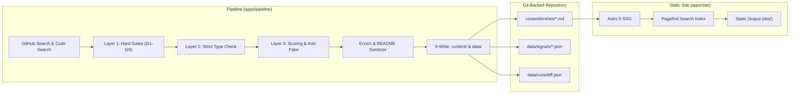

# 07. Project Checkpoint Status & Production Readiness Report

> **Date:** October 2026  
> **Status:** Production Ready (v2.0 Architecture)  
> **Repository:** [`teikmin/web_dictionary`](https://github.com/teikmin/web_dictionary.git)  
> **Evaluator & System Audit:** Antigravity AI Pair Programmer

---

## 1. Executive Summary

The project has completed its transformation from an early experimental prototype into an authoritative, zero-maintenance, Git-backed registry and discovery hub for Model Context Protocol (MCP) servers and AI Agent Skills.

### Core Milestones Achieved
1. **Zero-Database Git-Backed Engine:** Supabase and runtime SQL databases are completely retired. Catalog entries live as validated Markdown documents with Zod-enforced YAML frontmatter in `content/entries/`, with weekly time-series metric snapshots recorded in `data/signals/`.
2. **Catalog Reliability Overhaul:** Resolved false-positive MCP detection, synthetic Docker command fabrication, and developer-internal skill pollution. Strict dependency parsing and multi-entry monorepo extraction now yield high-integrity tools.
3. **Frontend UX Overhaul (Phases A–E):** Re-architected from a landing page into a **browse-and-explore discovery directory**:
   - Primary `/catalog` live-filtered search directory with type, category, client, license, and official-only filters.
   - Read-first tool detail pages rendering sanitized, badge-stripped upstream READMEs and `SKILL.md` bodies (capped at ~60KB) before asking users to install.
   - Clean, cold-tone light theme with shared design tokens and zero continuous animation.
   - Honest labeling: removed all unverified claims ("verified / curated") across the entire codebase and UI.
4. **Verified 1-Click Client Launch Configs:** Tailored, tested snippets and install paths for **Claude Code**, **OpenAI Codex**, and **Google Antigravity**.

---

## 2. Monorepo Health & Test Verification

| Metric | Status | Details |
|---|:---:|---|
| **TypeScript Typecheck** | 0 errors | Clean across `@web-db/schema`, `@web-db/renderers`, `@web-db/pipeline`, `@web-db/site` |
| **Unit & Snapshot Tests** | 22 / 22 pass | Full coverage across schema validation, multi-client adapters, fixtures, and README sanitizer |
| **Astro SSG Build** | 706 pages | Builds in ~4.5s; generates static HTML with zero client-side hydration overhead |
| **Pagefind Search Index** | 706 pages | Indexed in ~1s; offline client-side full-text search with zero API billing |
| **Catalog Scale** | 690 entries | 124 verified MCP servers + 566 agent skills |

```text
Test Files  2 passed (2)
     Tests  22 passed (22)
  Start at  October 2026
  Duration  1.28s (transform 312ms, setup 0ms, collect 240ms, tests 48ms, environment 0ms, prepare 284ms)
```

---

## 3. Architecture & Data Flow



---

## 4. Official Agent Client Integration Paths

All configuration paths and command structures have been checked and verified against official developer documentation as of October 2026:

| Agent Client | Launch Command / Snippet Format | Default Workspace Config | Default Global Config | Skill Directory Location |
|---|---|---|---|---|
| **Claude Code** | `claude mcp add <name> -- <cmd>` or `.mcp.json` | `.mcp.json` | `~/.claude.json` | `.claude/skills/<name>/SKILL.md` |
| **OpenAI Codex** | `.codex/config.json` JSON block | `.codex/config.json` | `~/.codex/config.json` | `.codex/skills/<name>/SKILL.md` |
| **Google Antigravity** | `.gemini/mcp_servers.json` (`mcpServers` object) | `.gemini/mcp_servers.json` | `~/.gemini/antigravity/mcp_servers.json` | `~/.gemini/config/skills/<name>/SKILL.md` (or `.gemini/skills/`) |

---

## 5. Catalog Quality & Reliability Guarantees

### 5.1 Hard Gates (Layer 1)
- **G1:** `archived == false`
- **G2:** `fork == false` (except officially pinned vendor forks)
- **G3:** `is_template == false`
- **G4:** Minimum $\ge 100$ stars (official vendors exempt)
- **G5:** Pushed within 180 days
- **G6:** Repository age $\ge 30$ days
- **G7:** Valid OSI open-source license
- **G8:** Non-empty description ($\ge 20$ characters)
- **G9:** Excludes coursewares, tutorials, demos, and boilerplate lists

### 5.2 Strict Evidence Verification (Layer 2)
- **MCP Servers:** Verified exclusively via `@modelcontextprotocol/sdk` in `package.json`, exact `mcp` or `fastmcp` in `pyproject.toml`/`requirements.txt`, official Go/Rust SDKs, or manifest conformance.
- **Agent Skills:** Multi-entry extraction from qualifying `SKILL.md` files; rejects repo-internal hidden maintenance directories (`.claude/skills/`, `.cursor/skills/`).

### 5.3 Honest Launch Configurations
- No synthetic Docker tag guessing.
- No dummy `npx` fallbacks when no command is verified.
- Placeholder detection: entries with unresolvable placeholders are assigned confidence `none` and render a clear manual setup guide with an upstream link instead of a broken copy button.

---

## 6. Site Structure & Routes

| Route | Template | Features |
|---|---|---|
| `/` | `index.astro` | Search modal, category tiles with item counts, curated sections (Popular, Recently Updated, Official, New) |
| `/catalog` | `catalog.astro` | Unified directory with live JavaScript filtering (type, client, category, license, status), sorting, pagination, and URL state sync |
| `/mcp/[slug]` | `mcp/[slug].astro` | Read-first layout: header & signals strip &rarr; Table of contents &rarr; Sanitized upstream README &rarr; Details &rarr; Related tools &rarr; 1-Click install dock |
| `/skills/[slug]` | `skills/[slug].astro` | Agent skill layout: header & signals &rarr; Table of contents &rarr; Rendered `SKILL.md` &rarr; Related skills &rarr; Client copy instructions |
| `/client/[client]` | `client/[client].astro` | Pre-filtered view for Claude Code, OpenAI Codex, or Google Antigravity |
| `/category/[category]` | `category/[category].astro` | Pre-filtered view for vertical categories |
| `/changelog` | `changelog.astro` | Weekly diff of added, updated, and archived tools powered by `data/runs/*/diff.json` |
| `/about/criteria` | `about/criteria.astro` | Public transparency page explaining the automated quality formula |
| `/rss.xml` | `rss.xml.ts` | RSS feed for catalog additions and weekly ecosystem diffs |

---

## 7. Operational Runbook

### Running the Discovery Pipeline
```bash
# Dry run report (does not alter catalog content)
pnpm run pipeline:report

# Production refresh (discovers, enriches, updates content/entries and data/)
pnpm run pipeline:run
```

### Building & Serving the Site
```bash
# Run local dev server
pnpm run site:dev

# Build static production bundle + Pagefind index
pnpm run site:build

# Preview built static site locally
pnpm --filter @web-db/site exec astro preview --host
```

### Running Test & Typechecks
```bash
pnpm test
pnpm run typecheck
```

---

## 8. Summary of Active Documentation

| File | Status | Description |
|---|---|---|
| [`README.md`](file:///c:/teikmin/exploring/web_database/README.md) | Current | Quick start, verified client table, repo links, and project directory |
| [`docs/01_ARCHITECTURE.md`](file:///c:/teikmin/exploring/web_database/docs/01_ARCHITECTURE.md) | Current | Overall system topology, client adapters, URL structure, and roadmap |
| [`docs/02_REPO_QUALITY_CRITERIA.md`](file:///c:/teikmin/exploring/web_database/docs/02_REPO_QUALITY_CRITERIA.md) | Current | 3-Layer automated filter rules, scoring formulas, and anti-fake heuristics |
| [`docs/03_GROWTH_AND_SEO.md`](file:///c:/teikmin/exploring/web_database/docs/03_GROWTH_AND_SEO.md) | Current | Programmatic SEO URL matrix, structured JSON-LD, and virality loops |
| [`docs/04_FUTURE_ROADMAP.md`](file:///c:/teikmin/exploring/web_database/docs/04_FUTURE_ROADMAP.md) | Current | Scope discipline, deferred v1 non-goals, and future exploration ideas |
| [`docs/05_FOLDER_STRUCTURE.md`](file:///c:/teikmin/exploring/web_database/docs/05_FOLDER_STRUCTURE.md) | Current | Monorepo layout, schema shapes, folder ownership, and data lifecycle |
| [`docs/06_CATALOG_RELIABILITY_FIX_PLAN.md`](file:///c:/teikmin/exploring/web_database/docs/06_CATALOG_RELIABILITY_FIX_PLAN.md) | Completed | Post-mortem and resolution of type detection, genuine skills, and honest configs |
| [`docs/06_FRONTEND_UX_REVIEW.md`](file:///c:/teikmin/exploring/web_database/docs/06_FRONTEND_UX_REVIEW.md) | Completed | Frontend UX redesign spec and completed checklist (Phases A–E) |
| [`docs/07_CHECKPOINT_STATUS.md`](file:///c:/teikmin/exploring/web_database/docs/07_CHECKPOINT_STATUS.md) | Current | Production status report, test matrices, metrics, and operational runbook |
